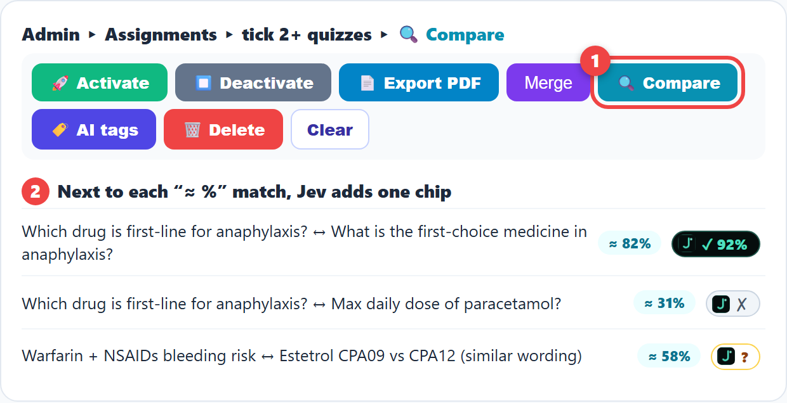
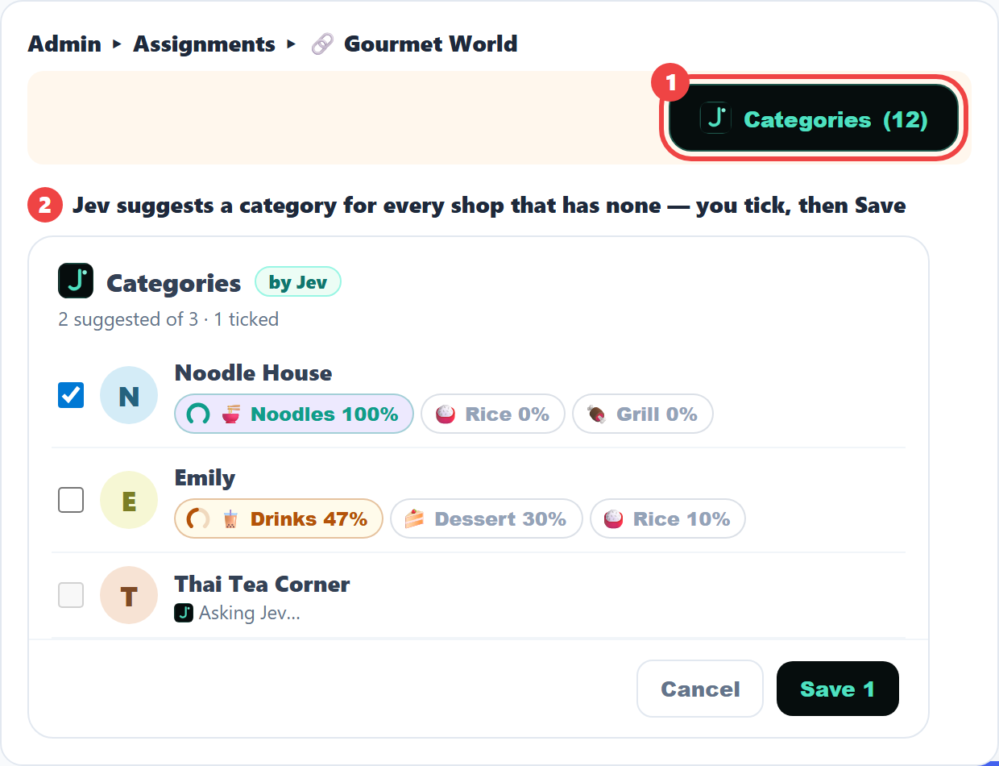
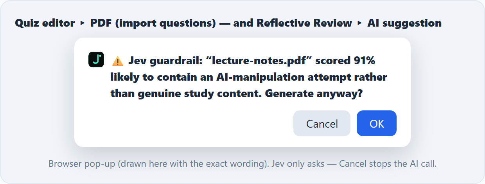

# 관리자 가이드 (Nika) — 처음 시작하기

페이지: https://mlpditto.github.io/INTERN-PORT/admin.html · 데스크톱과 휴대폰 모두 사용 가능 (탭 바는 옆으로 스크롤됩니다)

> 탭 단위 가이드 — 모든 버튼 이름은 실제 admin.html 화면에서 가져왔습니다 (헤더의 📖 버튼으로 이 가이드를 엽니다)

---

## 0. 🔑 로그인

**Admin Portal** 페이지에는 3가지 로그인 방법이 있습니다 — 하나만 사용하세요:

| 방법 | 사용법 |
|---|---|
| ✨ **Send Login Link** (권장) | 이메일 칸에 관리자 이메일이 미리 입력되어 있습니다 → 버튼을 누르고 → 메일을 열어 → 요청한 기기에서 링크를 누르세요 |
| **Google** | Google 버튼을 누르고 팝업에서 계정을 선택하세요 |
| **LINE** | LINE 버튼을 누르세요 (LINE 계정이 관리자 이메일에 연결되어 있을 때 작동) |

**알아두세요**
- 시스템은 **관리자 이메일 한 개만** 허용합니다 (코드에 설정됨). 다른 계정은 Google 로그인에 성공해도 `Access denied for …` 가 표시됩니다
- Firefox는 Google 팝업을 자주 차단합니다 → **Send Login Link** 를 사용하세요 (팝업이 차단되면 시스템이 이를 안내하고 링크 전송을 직접 시도합니다)
- 팝업을 중간에 닫았다면 → Google을 다시 누르면 됩니다

---

## 1. 🧭 헤더 (모든 탭의 맨 위)

| 버튼 | 기능 |
|---|---|
| ☀️ **Nika V…** | 페이지 이름 + 현재 실행 중인 버전 (이름 아래에 로그인한 이메일 표시) |
| ➕ **Create** | 새로 만들기 — **Task** (칸반 카드) · **Quest** (일일 퀘스트) · **Event** (공지) · **Article** (인턴이 앱을 열 때 뜨는 짧은 글) · **Quiz** · **Goals** · **Certificates** |
| 📥 **Archive** | 보관된 항목 보기 (Quests, Tasks 등) |
| 📱 **UI** | LINE 없이 인턴 화면 미리보기 (LIFF Preview) |
| 🔮 | AI Engine 설정 (키 / 모델) — "not loaded yet" 이라고 나오면 페이지를 새로고침하세요 |
| ⚓ | Grand Line Deck + Laugh Tale 의 One Piece 테마 켜기/끄기 |
| 🇺🇸 **국기** | 라벨 언어 — 국기가 현재 언어를 나타내며, 누를 때마다 🇺🇸 EN → 🇰🇷 KR → 🇹🇭 TH → 🇰🇷🇹🇭 두 언어 순으로 바뀝니다 |
| 🌓 | 라이트 / 다크 모드 전환 |
| 👋 **Logout** | 로그아웃 |

---

## 2. 🗺️ 탭 지도 — 별명 → 실제 역할

| 탭 | 무엇인가 | 먼저 할 일 |
|---|---|---|
| 📊 **Dashboard** | 홈: 작업 대기열 + 칸반 + 통계 | 맨 위 칩 바의 숫자를 확인하세요 — 0이 아닌 칩은 처리할 일이 있다는 뜻입니다 |
| 📦 **Assignments** | Quiz, 시험, 맛집 리뷰 링크, 보상 상점 관리 | 탭의 **빨간 배지** = 검토 대기 중인 Quiz |
| 👥 **User Hub** | 인턴 목록, 점수, 순위, 그룹 | 인턴을 검색하면 기록과 점수를 볼 수 있습니다 |
| 🏴‍☠️ **Grand Line Deck** | 팀용 AI 도구 (채팅, 이미지 생성, Podcast Studio) | 필요할 때 사용 — 대기 중인 작업 없음 |
| 🏝️ **Laugh Tale** | 인턴의 **Reflections** 와 **Quiz feedback** 검토 | AI가 "Needs a fix" 로 표시한 피드백을 여세요 |
| 🏜️ **Alabasta** | **Case** (환자 사례)와 **Product** (제품 등록) 검토 대기열 | Pending 필터 → 하나씩 검토 |
| 🪨 **Poneglyph** | Codex (**Drug** / **Disease**), My Path, Memories | 인턴이 제출한 Drug/Disease 초안을 검토하세요 |

### 📊 Dashboard
- **맨 위 칩 바** (눌러서 목록 열기): 👤 Access (접근 요청) · 📖 Review (Reflective Review) · 💰 Claimed (요청된 포인트) · ⏱️ Quiz (대기 / 지연) · 💼 Work · 💊 Drug Drafts · 🩺 Disease Drafts · 📥 New Cases
- 🚀 **Up next** + 🎯 **Live quizzes**: 진행 중인 모든 Quiz를 긴급도 × 완료 인원 표로 보여 줍니다 — 🔥 Do first · 📅 Plan · ⏳ Watch · ✅ On track. 기준은 ⏱ 24시간 / 72시간 / 7일, 👥 30 / 50 / 70 %로 정합니다
- 💬 **Journal feedback**: 인턴이 Journal에서 보낸 메시지입니다. **↩ Reply**를 누르면 그 인턴의 History에서 메시지 아래에 답변이 표시됩니다 · **✓ Mark read**
- **모델 칩의 파란 점** = Google Cloud 크레딧에서 먼저 차감
- **칸반**: Backlog → 🚧 Doing → 👀 Review → ✅ Done (Tasks 검색; 오래된 항목은 Show archived)
- **🚀 Escalated**: 인턴이 특별 주의를 요청한 학습 노트 · **🗑️ Note deletion requests**: 노트 삭제 요청
- **AI usage · Overview**: AI 사용량 요약 + 히트맵 (눌러서 열기)
- **Quiz Coverage by System**: Quiz가 다루는 신체 계통
- **LINE pushes this month**: 이번 달 발송된 푸시 + **Preview digest** / **Send this now** / **Copy text** (메시지를 복사해 그룹에 직접 붙여넣기 = 푸시 횟수 소모 없음)

### 📦 Assignments (하위 탭 4개)
- 🧠 **Quiz Engine**: 칩으로 필터링하는 Quiz 목록 (GRADED · TEMPLATE · ONE-TIME · 🔒 LOCKED · 📎 MATERIALS · 🧪 NOT AUDITED · 🏷️ INCOMPLETE); 여러 개를 선택한 뒤 🚀 Activate · ⏹️ Deactivate · 📄 Export PDF · Merge · 🔍 Compare · 🏷️ AI tags · 🗑️ Delete · 🌐 Translate Missing 사용
- 🎓 **Exam**: 시간제 시험실 (Quiz + Host + 총 시간 선택; 상태 Lobby / Running / Paused)
- 🔗 **Gourmet World**: 맛집 리뷰 링크 (➕ Add Link, 🖼️ Fetch missing logos; 로고는 링크 / 업로드 / 🖼 Image link 에서 가져옴)
- 🏪 **A Shop for Killers**: Beri 보상 상점 — 이름, 링크, 로고, 유형, Beri Reward 설정

### 👥 User Hub
- 🏆 **Elite Board** (순위) · 검색창 · 📅 점수 기간 · 🏅 **Badge Stats** · 📤 순위 공유 · 🛡️ **Divisions & Groups** · 👥 **Entry** (사전 등록) · ⏳ 일일 체크인 누락으로 차감될 포인트 미리보기
- 인턴 한 명의 기록(드릴다운)을 열고 Q (Quiz) · W (Work) · L (Logs) · B (Bonus) · M (Manual) · 📍 Check-in · 🪙 Beri 로 필터링
- 🛡️ **Divisions & Groups** (툴바의 방패 버튼) — *group* 은 사람의 소속 팀이고, *division* 은 **함께 순위가 매겨지는** 사람들의 묶음이며 특별한 UI를 켤 수 있습니다 (**Content Creator** 라는 division 의 구성원은 Mission 대신 Content 카드를 받습니다). 사람의 division 은 **본인의 설정**(`users.division`)이므로 **같은 group 이름이 여러 division 에 있을 수 있습니다**. division 이 없는 사람은 **Only I** 에 속합니다 (자기 group 안에서만 순위). 이전에 만들어진 문서도 계속 작동합니다: division 이 설정되지 않았다면, 그 사람의 group 이 들어 있는 division 으로 간주됩니다.
  - Group **목록**은 **초안**입니다: 마음껏 추가 / 삭제할 수 있고 **Save** 를 누르기 전에는 아무것도 저장되지 않습니다 (목록이 달라졌을 때만 Save 바가 나타남. 예: "+ Audit in RSU"). Save 없이 닫으면 변경이 버려집니다. **사람 이동은 즉시 저장됩니다** (아래 참고).
  - 맨 위 줄은 **division 레일**입니다 (각각 고유 색, 그리고 **Only I**); 칩의 숫자는 활성 인원입니다. 하나를 누르면 아래에 그 group 들이 표시됩니다 (목록 + 소속 인원의 group). 맨 위 **검색**은 모든 division 을 한 번에 찾습니다; 다른 곳에 있는 group 을 입력하면 **＋ Add “X” to this division**, 완전히 새 이름이면 **＋ New group “X”** (division 목록에 유지되는 빈 group)가 나타납니다
  - **Division 만들기**: 레일 끝의 둥근 ＋ → 이름 입력 → ＋ (Save 후 사람을 옮길 수 있음) · **사람 이동**: group 칩을 누르면 그 아래에 **사람들**이 표시됩니다 (이름을 누르거나 **All**) → **Move N →** division 또는 **Only I** — 즉시 저장, group 이름은 유지 · **division 목록에서 group 제거**: ⊖ (아무도 없을 때만) · **Division 삭제**: 패널 제목 오른쪽의 ✕ (구성원은 Only I 로 돌아가며 아무것도 삭제되지 않음)
  - **Look (🎨)**: group (선택한 group 의 액션 바에 있는 🎨) 또는 division (제목의 ✕ 옆 🎨) 의 색 · 아이콘 · 사진. 선택은 즉시 저장되고, 해당 group / division 을 표시하는 모든 칩이 따라 바뀝니다 (Users 레일, User Hub, Elite Board, 행 태그). 사진은 아이콘 자리를 대신하며(원형), **↺ default** 는 기본 모양으로 되돌립니다.
  - **Memberships ("also")**: 한 사람은 하나의 division 에 **주 group 하나**(포인트, 순위, Quiz, 스트릭)를 가지며, 다른 division · group 쌍에 **추가로** 속할 수 있습니다 — User Hub group 행의 "also" 뒤 **＋** 를 누르면 같은 ① Division → ② Group 선택기가 열리고, 쌍은 흐린 **EXTERN | RSU** 칩으로 표시됩니다 (누르면 제거). 구성원은 그 division 에서 집계되고 (Users 레일, Divisions & Groups 의 점선 이름, Elite Board) 해당 업무를 볼 수 있지만, 그곳에서 옮겨지지는 않습니다 — 변경은 User Hub 에서 하세요.
  - ⚠️ 같은 바에서 아이콘(✏️ Rename · ⇄ Merge · 👁 Visibility · 🗑 Delete, ⚡ 표시)은 **group 자체**에 작용하며 Save 가 아니라 **즉시 적용**됩니다 — Delete 는 모든 곳에서 group 을 제거합니다
  - 칩의 숫자는 활성 인원만 센 것입니다 (숨김 / 미등록 제외) · 코드가 특별 취급하는 division 이름: **Content Creator** (또는 예전 이름 CAFE)

### 🏝️ Laugh Tale
- 📓 **Reflections** (성찰 노트)와 🧠 **Quiz** (Quiz 피드백)에는 각각 **Needs a fix · Analysis · Patterns · Comments** 탭이 있습니다
- 분석에 사용할 AI 모델은 제공업체 로고 칩으로 선택합니다
- 👒 **Straw Hat Mode**: 인턴 신원 숨기기 / 보이기 · 📐 LP Taxonomy 편집 · 여러 개 선택 후 🗑 Delete selected

### 🏜️ Alabasta
- 🩺 **Case** / 🛒 **Product** 전환 · 칩 All / 📥 Pending / ✅ Reviewed / ❌ Rejected · 기간 · 🔎 검색 · ⬇️ CSV
- **Case 반려**: 사유를 선택하세요 (데이터 불완전 · 중복 · 관련 없음 · 기타) — 인턴은 자기 기록에서 그 사유를 봅니다
- 여러 개 선택 → ✅ Bulk Review / 🗑️ Bulk Delete
- **⋯** 메뉴: ⚙️ Edit Case Taxonomy · 🔧 **Sync intern view** (검토된 case/work 를 동기화해 인턴이 볼 수 있게 함) · 🔎 Scan orphan history (검색만 하며 삭제하지 않음)

### 🪨 Poneglyph
- 💊 **Drug Codex** · 🩺 **Disease Codex** (데이터 편집, 다운로드 파일 링크 첨부) · **My Path** (관리자 본인의 학습 노트 + 🧭 AI Learning Path) · 🎟️ **Memories** (완료한 활동과 스탬프)
- 📊 **Monitor: Intern Learning Paths** 에서 인턴의 LP 노트를 확인 · 🗑️ Trash
- 인턴의 노트를 수정 / 삭제하려면 감사 로그를 남기기 위해 **사유**가 필요합니다 (삭제는 소프트 삭제 — Trash 에서 복구 가능)

### 📝 Quiz 편집기
- **Read first**: **✨** 는 이 문항만 초안을 만듭니다 (정답은 AI에 보내지 않습니다). 초안 뒤에 **☰ Terms only** 를 고를 수 있습니다. **📖 All** 은 퀴즈 전체를 열어 반복 용어를 표시하고, 팝업에서 바로 수정하며, **✨ All** 은 그곳에서 고른 모델로 빈 문항을 채웁니다
- **✨ Scene** (🖼 이미지 패널): 문제 상황 그림 — 정답이 드러나지 않는지 확인하는 AI 그림, 또는 숫자로 만든 차트. **Insert** 로 문제에 넣습니다
- **🎓 Practice** (Logic): 인턴에게 문항마다 **✓ Check** 가 표시됩니다. 정답이 보이므로 시험 세트에서는 꺼 두세요
- **Rank** 문항: 인턴이 답을 한 번 입력한 뒤 선택지를 순서대로 고르거나 Best / OK / Avoid 로 나눕니다. **✨ Draft with AI** 로 초안을 만든 뒤 수준과 ⚠ 표시를 확인하세요
- **AI Curate**: 활성 퀴즈에서 Remove 또는 Split 을 누르면 먼저 확인한 뒤 같은 단계에서 퀴즈를 비활성화합니다

### 🔍 응시 검토
- 헤더는 한 줄이며 상태는 이름 옆에 표시됩니다. 승인 전에는 **🍎 100%** (만점) 또는 **🍇 점수** (실제 점수)를 고르고, 승인 후에는 고른 과일이 상태로 남습니다
- 📰 **Personal review** (신문 아이콘, 틀린 문항이 있을 때 표시): 국기를 눌러 언어를 고르고 모델을 선택한 뒤 **✨** 를 누릅니다. 그 전에는 AI가 실행되지 않으며 인턴 이름은 보내지 않습니다. 수정 후 **📨 Send** 를 누르면 퀴즈 결과와 History에 표시됩니다. `**굵게**` 는 강조로 보입니다

### 📰 Articles
- ➕ **Create ▸ Article**. **✨ Draft** 는 붙여 넣은 메모를 2,000자 이내의 짧은 이야기로 만들고, **✨ Episode 2** 는 이어서 씁니다
- 인턴은 💬 **Any Q?** 로 질문합니다. Dashboard 칩이 열린 질문 수를 세며 ⚠️ "틀림/오래됨"이 먼저 나옵니다. **↩ Reply** 는 인턴의 History에 표시되고 질문자 이름은 숨겨집니다

---

## 3. 📅 하루 루틴 (순서 예시)

1. **Dashboard** 를 열고 → 맨 위 칩을 확인합니다. 0이 아닌 칩은 처리할 대기열입니다
2. 📦 **Assignments** 의 빨간 배지를 확인 → 대기 중인 Quiz 를 검토합니다
3. **Alabasta** → Pending 필터 → Case / Product 를 검토합니다
4. **Laugh Tale** → Quiz 피드백의 "Needs a fix" 를 확인합니다
5. 🎯 **Live quizzes** → 🔥 Do first 부터 시작합니다

---

## 4. ⚠️ 주의

- **모든 작업은 실제 데이터(운영 환경)에 기록됩니다** — 내 컴퓨터(localhost)에서 이 페이지를 열어도 마찬가지입니다. 테스트 모드는 없습니다
- **Delete / Bulk Delete / Archive** 는 일부 항목에서 되돌릴 수 없습니다 — 확인하기 전에 선택 항목을 점검하세요
- **Send this now** (Dashboard)는 그룹에 실제 LINE 메시지를 보냅니다. 문구만 필요하면 **Copy text** 를 사용하세요
- Case 를 검토 / 반려했는데 인턴에게 예전 상태가 보인다면 Alabasta → ⋯ → 🔧 Sync intern view 를 시도해 보세요

## 5. 🔧 문제 해결

| 증상 | 해결 방법 |
|---|---|
| `Access denied for …` | 지정된 관리자 계정으로만 로그인하세요 |
| Google 팝업이 나타나지 않음 | ✨ Send Login Link 를 사용하세요 (특히 Firefox) |
| 일부 버튼을 누르면 `Admin required` | 로그아웃 → 다시 로그인 → 그래도 표시되면 시스템 소유자에게 알려 주세요 (계정에 서버 측 권한이 아직 없음) |
| 🔮 버튼에 "not loaded yet" 표시 | 페이지를 새로고침하세요 |
| 숫자 / 목록이 오래되어 보임 | 새로고침(Ctrl+F5) — 버전이 바뀐 뒤 브라우저가 예전 파일을 쓸 수 있습니다. Nika 이름 옆의 버전 번호를 확인하세요 |

---

## 6. 🧠 Jev — AI 도우미

**Jev** 는 “이 두 문제가 같은 사실을 묻나요?”, “이 가게는 어떤 카테고리인가요?” 같은 짧은 질문에 답하는 작은 AI 입니다. **로고(진한 사각형 안의 청록색 J)** 와 어두운 색 + 청록색으로 알아볼 수 있습니다.

> **Jev 는 제안만 합니다.** 스스로 저장·삭제·채점하지 않습니다. 선택하고 체크하고 Save 를 누르는 것은 항상 관리자입니다.

### 앱에서 Jev 가 있는 곳

| 위치 | Jev 가 하는 일 | 관리자가 할 일 |
|---|---|---|
| 📦 **Assignments** → 퀴즈 2개 이상 체크 → **🔍 Compare** | 각 “≈ %” 일치 옆에 **칩** 표시: **✓ 92%** = 같은 사실 · **✗** = 다름 · **?** = 확실하지 않음 | 두 문제를 읽고 어느 쪽을 남기거나 고칠지 결정 |
| 📦 **Assignments** → 🔗 **Gourmet World** → **Categories (n)** | 카테고리가 없는 모든 가게에 카테고리 제안 | 동의하는 것만 체크 → **Save** |
| **Quiz editor → PDF**(문제 가져오기), **Reflective Review → AI suggestion** | 조용한 **가드레일**: 다른 AI 로 보내기 전에 “이전 지시를 무시해…” 같은 속임수가 있는지 확인 | 경고가 뜰 때만: **Cancel**(중단) 또는 **OK**(계속) |

### 🔍 Compare — 중복 문제

1. **Assignments** 에서 퀴즈를 2개 이상 체크하고 **🔍 Compare** (1) 를 누릅니다.
2. 비슷한 문제 쌍마다 단어 겹침 “≈ %” 가 보이고, 잠시 뒤 **가장 비슷한 60쌍**에 **Jev 가 자신의 칩을 추가**합니다 (2):
   - **✓ 92%** (어두운색 + 청록) — **같은 사실**을 묻는 문제: 한 문제를 풀면 다른 문제의 답을 알게 됨
   - **✗** (회색) — 표현이 비슷해도 **다른 사실**
   - **?** (노란 테두리) — Jev 가 **확신하지 못함**: 직접 두 문제를 읽어 보세요
3. 칩이 없다면? Jev 가 꺼져 있거나 답하지 못한 것입니다. “≈ %” 는 그대로 사용할 수 있습니다.

### ⚡ Categories — 카테고리 없는 가게

1. **Categories (n)** 버튼 (1) 은 카테고리가 없는 가게가 있을 때만 나타납니다 (n = 가게 수).
2. Jev 는 가게마다 최대 3개의 추측과 % 를 보여 줍니다. **확신이 높은 답(80% 이상)은 이미 체크되어 있고, 애매한 답은 체크되지 않으며** 주황색으로 표시됩니다 (2).
3. 다른 칩을 눌러 추측을 바꾸고, 동의하는 가게를 체크한 뒤 **Save**. 체크한 것만 저장됩니다.

### 🛡️ 가드레일 — Jev 가 경고할 때

PDF 텍스트(또는 인턴의 reflection)가 다른 AI 로 가기 전에, Jev 가 그 텍스트가 **학습 내용인지, AI 를 향한 지시인지** 확인합니다. 70% 이상이면 이 팝업이 뜹니다: **Cancel** = 중단, **OK** = 그래도 진행. Reflective Review 에서는 경고된 텍스트의 AI 문법 검사가 건너뛰어집니다. Jev 가 답하지 못하면 아무것도 막지 않고 작업은 그대로 진행됩니다.

### 비용과 확인 위치

- Jev 는 **Jev AI** 계정(토큰)으로 동작합니다. 비교 1회 또는 가게 1곳에 대략 300–600 토큰이 듭니다. 잔액은 Jev AI 대시보드(**Token account**)에서 확인합니다.
- **기술 관리자용:** Firestore `quiz_dup_scores/_config` → `{ enabled: false }` 는 Compare 칩과 Categories 를 끕니다. `{ provider: "openrouter" }` 는 같은 질문을 OpenRouter 로 보냅니다 (배포 불필요).

---

## 7. 🏴‍☠️ Deck — 이미지·영상·오디오

탭 **🏴‍☠️ Grand Line Deck** → 상단 세 모드: 🏴 Miss Goldenweek · 🧭 Log Pose · 🐳 Laboon.

### 🖼 이미지

**위치:** 🏴 Miss Goldenweek

1. 왼쪽 **Visual Style Collection**에서 스타일 선택 (Pirate Crew Life, Jolly Roger Vector, 3D Devil Fruit, Grand Line Map, Oda Manga Style, Wano Arc Anime). 모든 프롬프트에 적용됩니다.
2. **🪄 Vision** 상자에 그림을 설명 — 제목 옆 공식 *Context + Goal + Source + Expectations*. 태국어도 됩니다.
3. 상자 아래 툴바의 ✒ 은 **enhancer 모델**(글을 구조화된 영어 프롬프트로 바꿈; 로고 탭 = 제공사, 칩 = 모델). **engine** 선택: **Nano Banana 2.1**(Google, 가장 저렴, 도표·인포그래픽에 적합) 또는 **Image 2**(OpenAI, 글자에 강함).
4. **✨ Create** — enhancer가 영어 프롬프트를 먼저 보여주고(수정/확인) engine이 렌더링합니다.
5. 결과는 미리보기 카드에: 다운로드, Codex로 보내기, 다른 engine으로 다시 생성.

> 지난 이미지는 아래 **Codex Gallery**(종류 필터, Refresh). 각 이미지 아래에 그린 engine이 표시됩니다.

### 🎬 영상

**위치:** 🏴 Miss Goldenweek. 카드 위 단계 띠가 현재 위치를 보여줍니다: ① Intent ② Brief ③ Style ④ Plan (free) ⑤ Render (paid) ⑥ Review.

1. **Intent**: 오른쪽 위 칩 **🖼 Image** · **🎬 Series ×10** · **🎞 One clip**. 아래 engine 줄이 그 계열로 바뀌고 선택은 기억됩니다.
2. **Brief**: 네 칸 📄 Context · 🎯 Goal · 📚 Source · ⭐ Expectations (태국어 가능); 한 프롬프트로 합쳐집니다. **⇄ Free text**로 한 칸 입력으로 전환.
3. **Style**: 칩 하나 (약국 스타일 먼저, 고령 환자용 **Easy to see**, One Piece 여섯 스타일은 **🏴‍☠️ One Piece** 칩 뒤에). 스타일 문구가 모든 프롬프트 끝에 붙고 🛡️ Always added 줄(원작 캐릭터, 로고 없음)도 함께; 선택은 기억됩니다.
4. **Plan** (free): 왼쪽 아래 줄이 텍스트 모델(로고 탭 = 회사, 칩 = 버전). **Plan 10 episodes** (또는 **Plan 1 clip**) → **Episodes** 카드: 영/태 제목, 목표, 핵심 사실, 대사 1줄, 그림 1장, 태국어 자막. ✏️로 행을 바로 수정합니다.
5. **Render** (paid): engine 칩 선택(이름 아래 8초 가격): **Clip 9:16** Gemini Omni Flash ≈ $0.80 · **Veo Lite** ≈ $0.40 · **Kling** ≈ $1.01 · **HeyGen** ≈ $0.40 (아바타 진행자) · **Seedance** ≈ $1.84. 그다음:
   - 에피소드 하나의 **▶** → 그 행에서 **≈ $ · 8 s → Render** 확인 후 9:16 720p 오디오 포함 클립을 렌더링.
   - 여러 에피소드 **☑** → 바에 개수와 합계, **▶ Render n · one at a time**; 확인 한 번, 클립을 차례로 렌더링, **⏹ Stop after this one**으로 중단.
   - 끝난 클립은 자동 저장: Storage `teach-clips/{series}/EPnn.mp4` + `clip_series` 문서, **Codex Gallery → 🎬 Clips**에 표시. 업로드 실패 → 바의 **💾 Save all (n)**.
6. **Review**: 카드에서 재생(EP, 모델, 렌더 시간, 비용): **⬇ Download** MP4 (720×1280) · **CC ไทย / 🔊 เสียงไทย** (아래 🗣️ 태국어 클립 참고) · **🗑** 영구 삭제(먼저 확인; 에피소드는 planned로).

> 돌아온 클립마다 과금; 확인 없는 "전체 렌더링"은 없습니다. engine의 태국어 음성은 아직 고르지 않으니 태국어 음성은 아래 🗣️ 태국어 클립대로 만드세요.

### 🗣️ 태국어 클립

**위치:** 🏴 Miss Goldenweek → 계획 후 **Episodes** 카드, 그리고 **Codex Gallery → 🎬 Clips → ▶**

영상 engine의 태국어 음성은 아직 믿기 어렵습니다. 실제 쓰는 방법: engine은 그림만 그리고, 앱이 태국어 자막과 Gemini TTS 태국어 음성을 위에 얹습니다 (클립 자체 소리는 음소거).

1. **Plan**은 에피소드마다 한 줄 **태국어 자막**을 줍니다. Episodes 카드에서 ✏️로 말하게 하고 싶은 문장으로 고칩니다. 입력란 아래 카운터가 음성 길이 ≈ 초를 클립과 비교해 보여줍니다. ×1.35로 빨리 해도 길다고 하면 줄이세요.
2. **약 이름 읽기(음성 전용)** 란: `Warfarin=วอร์ฟาริน, INR=ไอเอ็นอาร์`, 쉼표 구분. 음성을 만들 때만 쓰고 자막 철자는 그대로입니다.
3. 아무 engine으로 **▶ Render** (Veo Lite가 가장 저렴, ≈ $0.40). Expectations에 "no on-screen text, no speech"를 넣어 그림이 자막·음성과 겹치지 않게 합니다.
4. 클립 카드(또는 갤러리 ▶ 플레이어)에서: **CC ไทย** 자막 띠 켜기/끄기 · **🔊 เสียงไทย** Gemini TTS 음성을 만들어 클립과 맞춰 재생(클립은 음소거); 상태 줄에 음성 길이와 가속 배율 · **Kore / Charon / Achird** 칩으로 목소리 선택(내레이터 / 차분 / 친근), 선택은 기억됩니다.
5. **⬇ MP4 + ซับ + 🔊** — 자막과 태국어 음성을 입힌 세로 MP4 저장(🔊 없이면 버튼은 **⬇ MP4 + ซับ**); 파일명 `EPnn-th-voice.mp4`.

> TTS는 글자당 과금, 클립당 몇 사땅. 음성은 목소리×문장별로 캐시되어 칩을 바꿔도 두 번 내지 않습니다. 시리즈 전체 전에 실제 문장 하나로 세 목소리를 들어보세요.

### 🐳 오디오

**위치:** 🐳 Laboon — 팟캐스트/음성 스튜디오 ("Brook, Soul King")

1. **Step 1 · Transcript** — 큰 상자에 대본 입력. **Polish**가 AI로 다듬음: Target Length, Script Format(독백/대화), Podcast Style, Summary Level. 옆에 대화 템플릿과 발음 도우미(어려운 영어 단어의 CMU 음소).
2. **Config(오른쪽 레일)** — 1. Model Selection(TTS 백엔드·음성 모델) 2. Production Language 3. Voice Rendering Mode 4. Performance Direction(톤·속도·강조). 휴대폰에서는 드로어.
3. **Step 3 · Produce** — Audio Encoding, Sample Rate 선택 후 **Generate**. 대본 아래에 플레이어가 나타나고 **Send to Podcast**로 팟캐스트 흐름에 전달, **Reset**은 초기화.

> TTS는 백엔드별 글자 수 과금 — 5분 대본은 몇 센트. 태국어 음성은 Cloud TTS·Gemini TTS 모두 가능; 짧은 문장부터 시험하세요.

### 🧭 Log Pose

**위치:** 🧭 Log Pose — 지식 베이스 위의 리서치 모델 채팅

- **Query Brain**에 질문(같은 Context + Goal + Source + Expectations 공식) 후 전송; **Suggest Prompts**가 시작점을 제안.
- 📎 **Attach Image for Vision Analysis** — 슬라이드·라벨·차트 이미지를 질문과 함께 전송.
- 사이드바 **Focus on KB Only**는 업로드 문서 안에서만 답하게 함; **Manage Documents**로 문서 추가/삭제.
- **Clear Chat**으로 새로 시작. 여기서는 DB에 쓰지 않음 — 위의 이미지·클립·대본을 준비하는 메모장.
